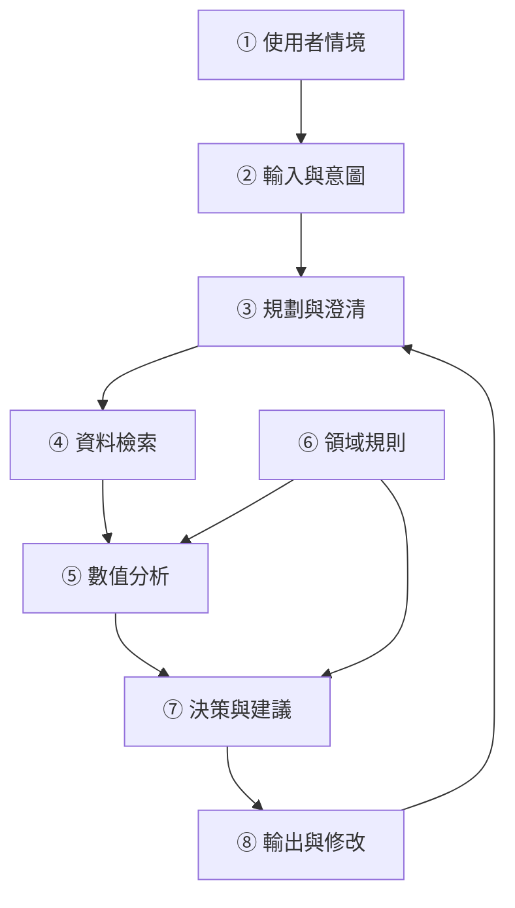
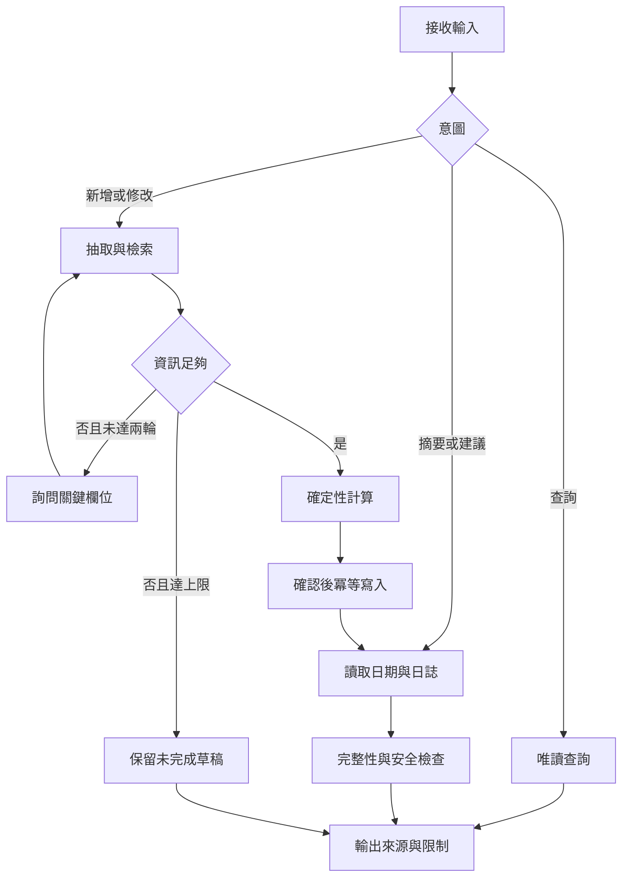

# DietSense DESIGN

 八模組架構


① 使用者描述餐點與實際日期。② 抽取食物、份量、烹調方式和餐別。③ 判斷缺失欄位並有限追問。④ 優先匹配在地、品牌與烹調狀態一致的資料。⑤ 計算熱量和巨量營養素。⑥ 管理單位、適用族群與安全規則。⑦ 結合完整性提供摘要。⑧ 顯示來源、假設、範圍與可修改項目。

## 7. 流程與演算法


```text
Algorithm 1: DietSense
Input: message, profile, journal, request_id
Output: response, updated_journal
01 initialize result fields to null
02 parse intent, food entities, event date and timezone
03 if intent is query: retrieve evidence and return read-only response
04 if intent is log or edit:
05   retrieve compatible food candidates
06   for round in 1..2:
07     if required information is sufficient: break
08     ask highest-impact clarification and update entities
09   if still insufficient: return pending draft without numeric invention
10   validate units, edible portion, source version and nonnegative values
11   compute energy and plausible range with deterministic arithmetic
12   request confirmation if assumptions materially changed the meal
13   upsert entry using request_id and entry_id
14 load requested day's entries and completeness flag
15 if energy profile is complete and applicable: estimate REE and TDEE
16 else: leave personal energy comparison unavailable
17 evaluate safety using completeness, context and explicit risk signals
18 generate source-grounded response without restrictive advice on risk
19 return response and updated journal
```

能量公式：E = 可食重量(g) × 每 100 g 熱量 / 100。若重量與熱量密度均為非負範圍，估算下限為兩者下限乘積，上限為兩者上限乘積。此為假設範圍，未經校準不得稱為 95% 信賴區間。

## 8. 十個失敗案例與驗收
|ID|失敗情境|預期行為|
|---|---|---|
|F01|只有「吃了一碗」|追問食物與份量，不猜測食物。|
|F02|未知家庭料理|允許拆解或回傳資料不足。|
|F03|兩來源的生／熟狀態不同|不直接平均，先對齊條件。|
|F04|API 逾時|使用有版本的快取並標示，否則保留待估。|
|F05|同一請求重送|同 request_id 只建立一筆。|
|F06|凌晨補登昨晚餐點|歸入使用者確認的實際用餐日。|
|F07|上午只記一餐|顯示紀錄未完整，不由低總量判定危險。|
|F08|個人資料缺漏|可顯示攝取，但不虛構 TDEE。|
|F09|資料含「忽略指令」文字|視為不可信資料，不改變工具權限。|
|F10|反覆要求極端限制飲食|停止提供進一步限制方案，提供支持性回應與專業協助方向。|

## 9. 評估設計
500 筆案例依料理／配方群組分為開發 100、驗證 100、測試 300 筆，避免同料理改寫洩漏。參考值需註明秤重、配方、標示或資料庫計算方法；不能把未經確認的人工猜測當標準答案。

主要指標：MAE（kcal）、Acc20（參考值大於零時相對誤差 ≤20% 的比例）、未完成率、來源追溯率、區間覆蓋率與平均寬度。零熱量案例獨立使用絕對誤差。失敗案例不得從主分析任意刪除。

20 人七天研究採平衡順序的交叉任務，控制熟悉程度與餐點難度；比較完整記錄時間、完成率及 SUS。小樣本短期試驗只支持可用性觀察，不足以證明長期減重效果。

消融實驗：完整系統、移除澄清、移除檢索三組，以驗證來源與互動的貢獻。凍結模型、提示、資料快照與測試集後再評估。

## 10. 重構前後檢討
|原稿問題|重構方式|
|---|---|
|把相關研究或來源未確認的統計寫成事實|刪除未查證的 85% 放棄率、醫療支出與「首次」宣稱。|
|檢索信心直接換算信賴區間|改為明示假設的份量／密度範圍，統計校準列為後續工作。|
|每日少於 1200 kcal 即判危險|加入紀錄完整性與情境，不以單一門檻診斷。|
|recommend 分支使用未定義 tdee|每次先讀取資料、初始化欄位並檢查是否可計算。|
|query 分支未完整實作|明確定義唯讀路徑，不修改日誌。|
|澄清可能無限循環|設兩輪上限與待完成狀態。|
|只有敘事目標|轉成 SHALL 需求、Scenario、任務與驗收表。|

