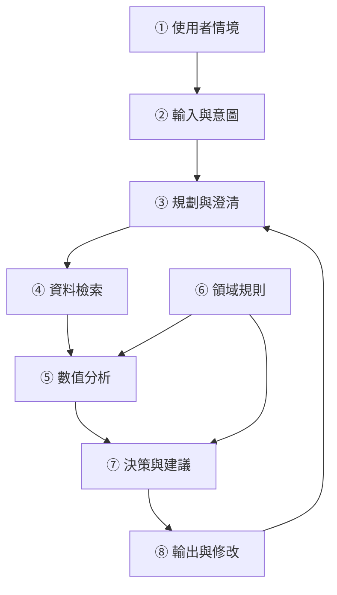
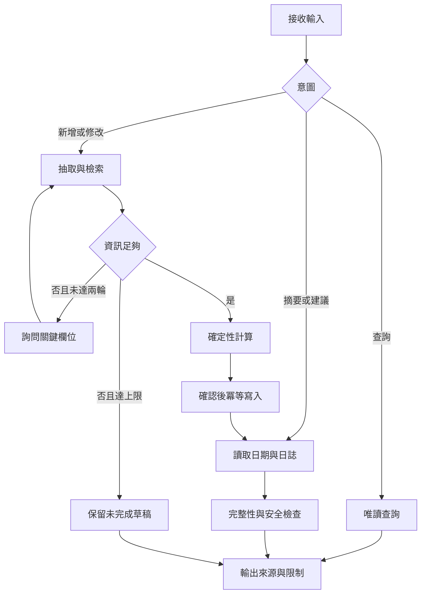

# DietSense：使用 OpenSpec 重構專題提案

## 1. 重構目的
將對話式飲食分析提案轉換為可追蹤、可實作、可驗收的規格。原提案的八個模組保留，但分離需求、技術決策與開發任務。本階段完成規格設計；500 筆資料集、20 人七天研究與效能數字均為規劃，並非實驗成果。

## 2. 摘要（A–F）
**A 動機：** WHO 於 2024 年公布，2022 年全球超過十億人處於肥胖狀態。飲食紀錄需要理解食物名稱、份量與烹調方式，日常外食尤其難以精確描述。[1]

**B 挑戰：** 自然語言輸入含有份量歧義、複合料理與缺少來源的估算。NutriBench 已研究文字飲食描述的營養估計，因此本專題不宣稱首次以 LLM 處理飲食紀錄。[2]

**C 解法：** 提出 DietSense，聚焦繁體中文與台灣外食，以資料檢索、澄清互動及可追溯計算支援飲食紀錄。

**D 方法：** LLM 負責意圖辨識與結構化抽取；營養資料由 USDA／台灣食品成分資料取得；數值由確定性程式計算；未知份量以明示假設的估算範圍表示。[3][4]

**E 評估：** 規劃建立 500 筆案例，按料理群組分割開發、驗證與測試資料，並進行 20 人七天可用性試驗。比較人工查表、純 LLM 與完整系統。

**F 預期產出：** 以熱量相對誤差不超過 20% 的案例比例大於 85%、記錄時間縮短 60%、SUS 大於 70 為待驗證目標。未達標時亦完整報告結果與失敗情境。

## 3. 五個核心思維與系統落實
|思維|意義與依據|設計決策|
|---|---|---|
|能量平衡是動態的|體重變化涉及攝取與消耗的長期變化。[5]|不從單日赤字直接承諾減重速度。|
|來源比流暢回答重要|RAG 提供外部證據，但檢索仍可能選錯。[6]|每筆估算保留來源 ID、版本、單位與假設。|
|份量與食物辨識是不同問題|知道食物名稱不代表知道重量。|分開記錄食物匹配狀態與份量範圍。|
|個體差異不能任意外推|個人化血糖研究不能直接證明個人熱量需求。[7]|能量公式標示適用限制，不生成臨床處方。|
|紀錄必須符合日常情境|多輪追問可能增加負擔，效益需實測。|每筆最多兩輪關鍵澄清，可保留未完成紀錄。|

## 4. 三個主要取捨
|取捨|方案 A|方案 B|本案選擇與驗證|
|---|---|---|---|
|準確度與操作負擔|逐項追問份量|直接估算|優先詢問油量、份量等影響較大的未知項；比較誤差與完成時間。|
|彈性與可重現性|LLM 自行算數值|固定公式與資料表|LLM 做語意理解，程式計算數值；記錄資料版本與模型版本。|
|個人化與資料最小化|大量健康資料|只收必要欄位|先支援一般成人飲食紀錄；只有使用者要求能量需求估計時才收公式必要資料。|

## 5. 十個深度問題與回答
1. **為何高檢索分數仍可能估錯？** 候選名稱相似不代表烹調方式、重量或可食部一致，必須另外檢查。
2. **只說一碗泡麵怎麼處理？** 詢問品牌／份量與加料；無回答則保留範圍和假設，不輸出偽精確值。
3. **何時停止追問？** 兩輪後仍不明確，提供可修改草稿或未完成狀態，不無限循環。
4. **資料庫找不到料理怎麼辦？** 經使用者確認拆成食材；無法拆解時回覆資料不足，不杜撰資料庫條目。
5. **怎麼驗證系統有效？** 同一組獨立測試案例比較基準，並將準確度、耗時與未完成比例一起報告。
6. **為何先選 RAG？** 營養資料需要更新與來源追蹤；微調可改善抽取，但不能取代資料版本管理。
7. **對話何時不適合？** 大量重複輸入可能比表單慢，故提供常用餐點與直接修改欄位。
8. **如何驗證夜市食物？** 以店家、配方與份量分組，建立秤重食材或標示參考值，並保留參考值本身的不確定性。
9. **能量需求公式是否適用所有人？** 否。Mifflin–St Jeor 是休息能量消耗的預測公式；特殊族群與臨床狀況需另行評估。[8]
10. **如何避免錯誤安全警示？** 區分當日紀錄尚未完成與完整一天；不把午餐前的低總量直接判定為限制飲食。

## 6. 八模組架構


① 使用者描述餐點與實際日期。② 抽取食物、份量、烹調方式和餐別。③ 判斷缺失欄位並有限追問。④ 優先匹配在地、品牌與烹調狀態一致的資料。⑤ 計算熱量和巨量營養素。⑥ 管理單位、適用族群與安全規則。⑦ 結合完整性提供摘要。⑧ 顯示來源、假設、範圍與可修改項目。

## 7. 流程與演算法


```text
Algorithm 1: DietSense
Input: message, profile, journal, request_id
Output: response, updated_journal
01 initialize result fields to null
02 parse intent, food entities, event date and timezone
03 if intent is query: retrieve evidence and return read-only response
04 if intent is log or edit:
05   retrieve compatible food candidates
06   for round in 1..2:
07     if required information is sufficient: break
08     ask highest-impact clarification and update entities
09   if still insufficient: return pending draft without numeric invention
10   validate units, edible portion, source version and nonnegative values
11   compute energy and plausible range with deterministic arithmetic
12   request confirmation if assumptions materially changed the meal
13   upsert entry using request_id and entry_id
14 load requested day's entries and completeness flag
15 if energy profile is complete and applicable: estimate REE and TDEE
16 else: leave personal energy comparison unavailable
17 evaluate safety using completeness, context and explicit risk signals
18 generate source-grounded response without restrictive advice on risk
19 return response and updated journal
```

能量公式：E = 可食重量(g) × 每 100 g 熱量 / 100。若重量與熱量密度均為非負範圍，估算下限為兩者下限乘積，上限為兩者上限乘積。此為假設範圍，未經校準不得稱為 95% 信賴區間。

## 8. 十個失敗案例與驗收
|ID|失敗情境|預期行為|
|---|---|---|
|F01|只有「吃了一碗」|追問食物與份量，不猜測食物。|
|F02|未知家庭料理|允許拆解或回傳資料不足。|
|F03|兩來源的生／熟狀態不同|不直接平均，先對齊條件。|
|F04|API 逾時|使用有版本的快取並標示，否則保留待估。|
|F05|同一請求重送|同 request_id 只建立一筆。|
|F06|凌晨補登昨晚餐點|歸入使用者確認的實際用餐日。|
|F07|上午只記一餐|顯示紀錄未完整，不由低總量判定危險。|
|F08|個人資料缺漏|可顯示攝取，但不虛構 TDEE。|
|F09|資料含「忽略指令」文字|視為不可信資料，不改變工具權限。|
|F10|反覆要求極端限制飲食|停止提供進一步限制方案，提供支持性回應與專業協助方向。|

## 9. 評估設計
500 筆案例依料理／配方群組分為開發 100、驗證 100、測試 300 筆，避免同料理改寫洩漏。參考值需註明秤重、配方、標示或資料庫計算方法；不能把未經確認的人工猜測當標準答案。

主要指標：MAE（kcal）、Acc20（參考值大於零時相對誤差 ≤20% 的比例）、未完成率、來源追溯率、區間覆蓋率與平均寬度。零熱量案例獨立使用絕對誤差。失敗案例不得從主分析任意刪除。

20 人七天研究採平衡順序的交叉任務，控制熟悉程度與餐點難度；比較完整記錄時間、完成率及 SUS。小樣本短期試驗只支持可用性觀察，不足以證明長期減重效果。

消融實驗：完整系統、移除澄清、移除檢索三組，以驗證來源與互動的貢獻。凍結模型、提示、資料快照與測試集後再評估。

## 10. 重構前後檢討
|原稿問題|重構方式|
|---|---|
|把相關研究或來源未確認的統計寫成事實|刪除未查證的 85% 放棄率、醫療支出與「首次」宣稱。|
|檢索信心直接換算信賴區間|改為明示假設的份量／密度範圍，統計校準列為後續工作。|
|每日少於 1200 kcal 即判危險|加入紀錄完整性與情境，不以單一門檻診斷。|
|recommend 分支使用未定義 tdee|每次先讀取資料、初始化欄位並檢查是否可計算。|
|query 分支未完整實作|明確定義唯讀路徑，不修改日誌。|
|澄清可能無限循環|設兩輪上限與待完成狀態。|
|只有敘事目標|轉成 SHALL 需求、Scenario、任務與驗收表。|

## 11. OpenSpec 工作流程與完成狀態
提案檔說明 why/what；specs 說明可觀察行為；design 說明技術決策；tasks 說明待實作工作。[9]

本次交付含完整提案重構、五項能力規格、設計、任務與驗收案例。本專案已提交 GitHub，並配置官方 OpenSpec CLI 安裝與 strict validation 工作流程，結果以 Actions 日誌為準。實際服務開發與研究資料蒐集仍待執行。

在可連網且已有 Node.js／npm 的環境，依官方安裝文件安裝後執行：
```powershell
npm install -g @fission-ai/openspec@latest
openspec --version
openspec init
openspec validate refactor-dietsense --strict
```
保留實際版本與命令輸出為安裝／驗證證據；實作完成前不 archive。此作業包未取得老師範例 repository 的可辨識網址，需在繳交前核對該 repository 是否另有指定檔名或模板。

## 12. 參考來源
[1] WHO (2024). One in eight people are now living with obesity. https://www.who.int/news/item/01-03-2024-one-in-eight-people-are-now-living-with-obesity

[2] Dhaliwal et al. (2025). NutriBench. ICLR 2025. https://proceedings.iclr.cc/paper_files/paper/2025/hash/ef3a57e4f26b640e6f90d78cbb011feb-Abstract-Conference.html

[3] USDA. FoodData Central API Guide. https://fdc.nal.usda.gov/api-guide/

[4] 食品藥物管理署。食品營養成分資料集。 https://data.gov.tw/dataset/8543

[5] Hall et al. (2011). Quantification of the effect of energy imbalance on bodyweight. https://pmc.ncbi.nlm.nih.gov/articles/PMC3880593/

[6] Lewis et al. (2020). Retrieval-Augmented Generation for Knowledge-Intensive NLP Tasks. https://arxiv.org/abs/2005.11401

[7] Zeevi et al. (2015). Personalized Nutrition by Prediction of Glycemic Responses. https://pubmed.ncbi.nlm.nih.gov/26590418/

[8] Mifflin et al. (1990). A new predictive equation for resting energy expenditure in healthy individuals. https://pubmed.ncbi.nlm.nih.gov/2305711/

[9] OpenSpec 官方文件。 https://github.com/Fission-AI/OpenSpec/blob/main/docs/concepts.md

來源查閱日期：2026-11-12。原作業依據：使用者提供之作業頁截圖、《期末專題提案作業規範》、《期中Proposal_熱量AI_Agent》與《A2Z outline example》。
